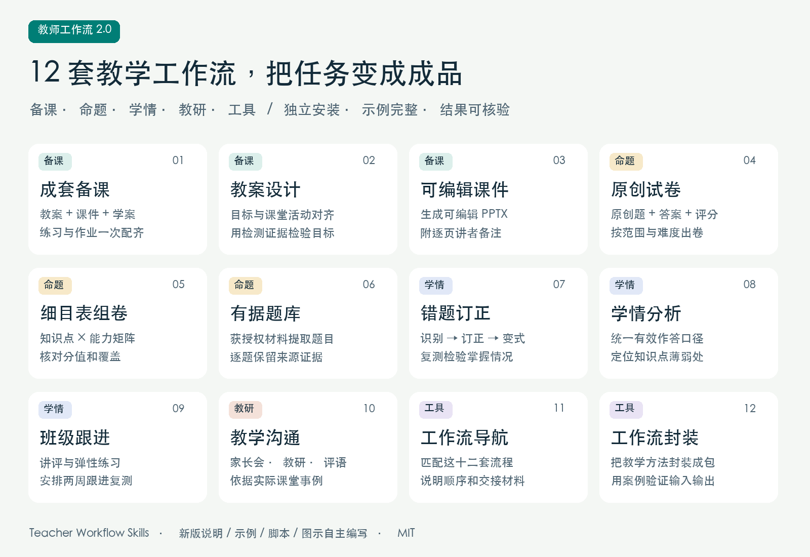
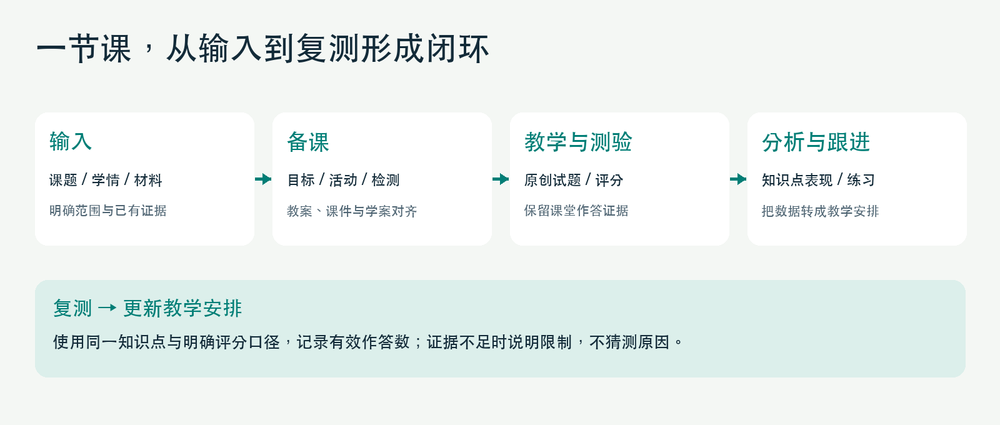
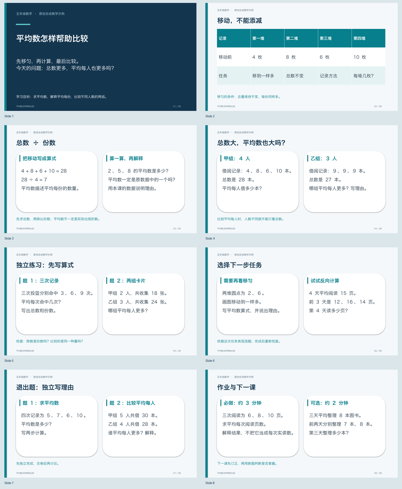
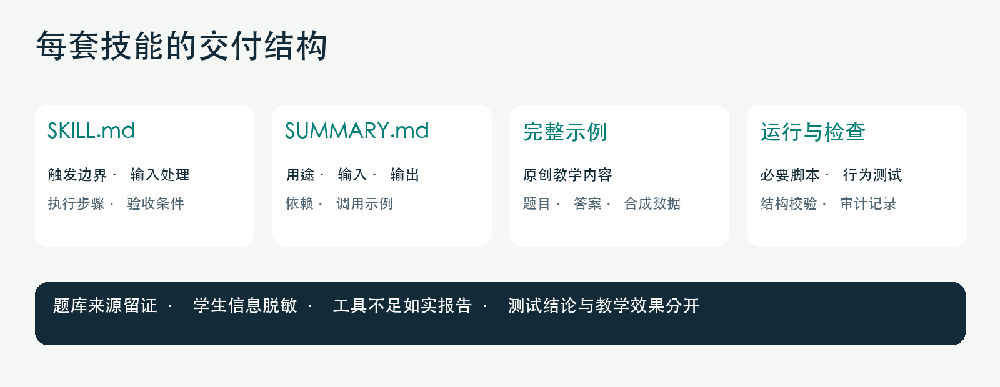

# 十二套教师工作流 · Teacher Workflow Skills

把备课、命题、错题、学情与教学沟通做成可重复调用的技能包。2.0 版重新编写全部流程，每套都配摘要、完整示例、输出规范和验收条件。



**12 套独立技能 · 原创重写 · 免费开源 · MIT · Python 3.11+（仅脚本需要）**

[下载完整发布包](https://github.com/szcodebox-dotcom/teacher-workflow-skills/releases/tag/v2.0.0) · [审核与验证记录](docs/AUDIT.md) · [安装指南](docs/QUICKSTART.md)

## WorkBuddy：一个教师专家，内置十二套技能

新增 **教师工作流专家包 1.0.0**：一个专家入口按需加载十二套技能，保留完整教学示例、四个可运行脚本，并附36条自然语言提示词、Windows/macOS安装与风险测试。

[下载 WorkBuddy 专家 ZIP](https://github.com/szcodebox-dotcom/teacher-workflow-skills/releases/download/workbuddy-v1.0.0/teacher-workflow-expert-v1.0.0.zip) · [WorkBuddy 安装方法](docs/WORKBUDDY.md)

解压后在 WorkBuddy「我的专家 → 创建专家」对话中提供完整文件夹，发送包内 `安装提示词.txt`；内置管理器完成复制、校验和注册。普通技能上传入口不能代替专家注册。本包采用官方专家插件结构，安装器不覆盖同名包；更新时保留备份与失败回滚。

## 十二套能做什么

| # | 工作流 | 输入 → 产物 | 技能包摘要 |
|---|---|---|---|
| 01 | [成套备课](teacher-lesson-pack/SKILL.md) | 一份输入生成教案、逐页课件内容、学案、练习和作业。 | [摘要](teacher-lesson-pack/SUMMARY.md) |
| 02 | [教案设计](teacher-lesson-plan/SKILL.md) | 把目标、课堂活动和检测证据对齐，输出可授课教案。 | [摘要](teacher-lesson-plan/SUMMARY.md) |
| 03 | [可编辑课件](teacher-slide-deck/SKILL.md) | 将教学内容制作为含讲者备注的可编辑 PPTX。 | [摘要](teacher-slide-deck/SUMMARY.md) |
| 04 | [原创试卷](teacher-exam-builder/SKILL.md) | 按考试范围生成原创题、答案和逐步评分规则。 | [摘要](teacher-exam-builder/SUMMARY.md) |
| 05 | [细目表组卷](teacher-blueprint-exam/SKILL.md) | 按知识点与能力矩阵组卷并核对题目和分值覆盖。 | [摘要](teacher-blueprint-exam/SUMMARY.md) |
| 06 | [有据题库](teacher-source-question-bank/SKILL.md) | 从获授权材料抽取题目，保留来源、页码和核验状态。 | [摘要](teacher-source-question-bank/SUMMARY.md) |
| 07 | [错题订正](teacher-mistake-coach/SKILL.md) | 保留识别证据，完成错题归类、订正、变式和复测。 | [摘要](teacher-mistake-coach/SUMMARY.md) |
| 08 | [学情分析](teacher-learning-insights/SKILL.md) | 统一得分口径，输出知识点表现、数据限制和复测建议。 | [摘要](teacher-learning-insights/SUMMARY.md) |
| 09 | [班级跟进](teacher-class-action-plan/SKILL.md) | 将测验证据转成讲评、弹性练习和两周跟进安排。 | [摘要](teacher-class-action-plan/SUMMARY.md) |
| 10 | [教学沟通](teacher-communication-studio/SKILL.md) | 根据真实证据形成家长会稿、教研材料与学生评语。 | [摘要](teacher-communication-studio/SUMMARY.md) |
| 11 | [工作流导航](teacher-workflow-router/SKILL.md) | 根据任务与现有材料匹配这十二套工作流并说明交接。 | [摘要](teacher-workflow-router/SUMMARY.md) |
| 12 | [工作流封装](teacher-workflow-maker/SKILL.md) | 把可复用教学方法写成有输入输出和验证案例的技能包。 | [摘要](teacher-workflow-maker/SUMMARY.md) |

## 一次调用，交付到哪里



成套备课生成教案、逐页课件内容、学案、练习和作业；只需要教案时调用教案设计，需要 PPTX 时调用可编辑课件。原创试卷负责新题，细目表组卷负责范围与分值覆盖，有据题库负责授权材料和来源。学情分析负责统计证据，班级跟进负责把证据转成讲评、练习与复测安排。

每个工作流只有在材料确实不足或用户要求阶段确认时才暂停。已明确的格式与要求直接用于制作成品。题目附答案，分析说明分母与缺失值，课件检查可编辑内容和讲者备注。

## 快速开始

下载仓库后，在仓库根目录安装全部技能：

```bash
python3 scripts/install.py --dry-run
python3 scripts/install.py
```

默认写入 Codex 技能目录；已有同名包会停止，替换需明确加 `--replace` 并保留备份。重启 Codex 后调用：

```text
使用 $teacher-lesson-pack，为七年级数学一元一次方程准备一节40分钟新授课。
交付教案、逐页课件内容、学案、练习和作业；题目附答案，直接完成。
```

不知道该选哪套：

```text
使用 $teacher-workflow-router：我有一份逐题成绩表，想安排下周讲评和复测。
```

详细安装、单包安装和任务示例见 [实操指南](docs/QUICKSTART.md)。文件夹技能可被支持该结构的其他助手读取；已验证范围见 [审核记录](docs/AUDIT.md)。

## 成品示例：可编辑课件



[下载实际 PPTX](teacher-slide-deck/assets/example-deck.pptx) · [查看完整内容 JSON](teacher-slide-deck/references/example-deck.json)。这是一份原创合成教学示例，八页均有讲者备注，文字与表格可编辑。其他十一套也各自附完整教学例子，可从对应摘要进入。

## 每套包都包含什么



```text
teacher-lesson-pack/
├── SKILL.md                 触发范围、输入、执行与验收
├── SUMMARY.md               技能包摘要和调用例子
├── agents/openai.yaml       界面名称与默认调用
└── references/
    └── worked-example.md    完整原创教学示例
```

需要确定性处理的技能另附 `scripts/` 与可运行输入示例：课件生成 PPTX，试卷核对机械一致性，学情计算有效作答统计。脚本不声称自动证明试题科学性或教学效果。

## 可运行检查与发布包

```bash
python3 -m venv .venv
source .venv/bin/activate
python -m pip install -r requirements-dev.txt
python scripts/validate_repo.py
python -m unittest discover -s tests -v
python scripts/build_release.py
```

发布包包含完整十二套技能、图文说明、审核报告、安装脚本及文件校验清单。生成目录为 `dist/`。各技能的脚本运行命令在其入口和摘要中给出。

## 原创与使用范围

新版正文、代码、合成教学示例和信息图自主编写；旧海报、旧正文与旧 ZIP 不进入新版。第三方真题需要可核实来源与使用权，班级数据需要脱敏。完整范围和检查方法见 [原创记录](docs/ORIGINALITY.md)，逐套升级见 [审核总表](docs/AUDIT.md)，命名迁移见 [迁移表](docs/MIGRATION.md)。

本仓库按 [MIT License](LICENSE) 授权。提供方法和可检查产物，不把合成案例当作课堂实测。欢迎提交具体问题、输入样本与预期输出来改进工作流。

维护账号：[szcodebox-dotcom](https://github.com/szcodebox-dotcom)。
