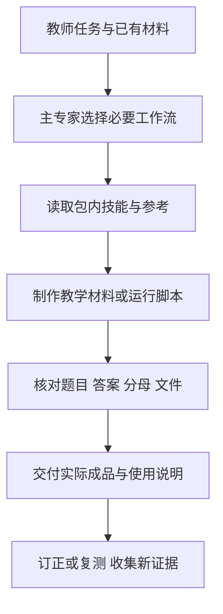

# 教师工作流专家 · WorkBuddy 专家包

**一个专家入口，十二套教学工作流，36条可复制提示词。**


按任务自动选择备课、教案、课件、命题、题库、错题、学情、班级跟进、教学沟通或工作流封装；保留十二套各自的完整说明、教学示例与四个实际脚本。需要 PPTX 就生成真实可编辑文件，统计说明缺失与分母，来源题保留授权和出处。

专家包版本 **1.0.0**，内置技能内容版本 **2.0.0**，MIT。原始源码：[teacher-workflow-skills](https://github.com/szcodebox-dotcom/teacher-workflow-skills)。

## 安装与开始

1. 阅读 [INSTALL.md](INSTALL.md)，解压完整目录。
2. 在 WorkBuddy「我的专家 → 创建专家」对话中提供此目录，发送 [安装提示词](安装提示词.txt)。内置专家管理器完成校验、复制与注册。
3. 选择“教师工作流专家”，从 [十二项介绍与36条提示词](USAGE.md) 中挑一项真实任务开始。

无需分别安装十二次。不依赖外部连接器，没有真实学生数据、凭据或第三方专家正文。

```text
召唤教师工作流专家，为五年级数学“平均数”备一节40分钟课。
先做3分钟前测，一次交付教案、学案、练习、作业和逐页课件内容，单列教师答案。
再用本包可编辑课件技能生成8页PPTX与完整内容JSON；核对页数、备注和答案。
```

## 一条完整交付路线



## 包内结构

```text
teacher-workflow-expert/
├── .codebuddy-plugin/plugin.json       专家与十二技能路径
├── agents/teacher-workflow-expert.md   主专家角色与路由
├── avatars/expert.png                 原创512×512头像
├── skills/teacher-*/                  十二套独立说明、示例和脚本
├── scripts/install_expert.py          在WorkBuddy会话校验与注册
├── scripts/verify_package.py          文件完整性与结构核验
├── scripts/run_examples.py            四个教学脚本完整复现
├── INSTALL.md                         安装、更新与Windows方法
├── USAGE.md                           十二介绍与36提示词
└── MANIFEST.json                      全部发布文件SHA-256
```

## 十二项能力

| 能力 | 输入与产物 |
|---|---|
| 成套备课 | 课题与课时 → 教案、课件内容、学案、练习、作业 |
| 教案设计 | 目标与条件 → 可直接授课的完整教案 |
| 可编辑课件 | 教学内容 → PPTX、JSON、讲者备注 |
| 原创试卷 | 范围与用时 → 学生卷、答案、逐点评分 |
| 细目表组卷 | 知识点与能力矩阵 → 覆盖可核对的试卷 |
| 有据题库 | 获授权材料 → 有出处、页码与核验状态的题库 |
| 错题订正 | 题面与作答 → 订正、变式、复测 |
| 学情分析 | 脱敏小题成绩 → 分母透明的统计与限制 |
| 班级跟进 | 测验证据 → 讲评、弹性练习、两周跟进 |
| 教学沟通 | 可核查事实 → 家长会稿、评语与教研材料 |
| 工作流导航 | 教师目标与已有材料 → 必要步骤与交接 |
| 工作流封装 | 可复用方法 → 完整Skill与正常/边界验证 |

复现脚本需 Python 3.11+；课件另需 `python-pptx`。安装脚本不自动安装依赖、运行教学脚本或开通连接器。兼容分类、验证范围与客户端安装差异见 [安装指南](INSTALL.md) 和 [验证记录](VALIDATION.md)。

## 原创与验证边界

主专家角色、安装辅助、整合说明和头像独立制作。内置技能是本仓库已经原创重写的十二套工作流，在副本中适配 WorkBuddy 双语元数据、自然语言调用和跨平台命令；不复制市场专家或第三方技能正文。教学例子与数据均为合成，不能冒充真实课堂效果。MIT授权见 [LICENSE](LICENSE)。
